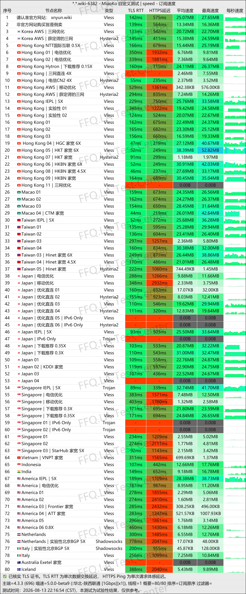
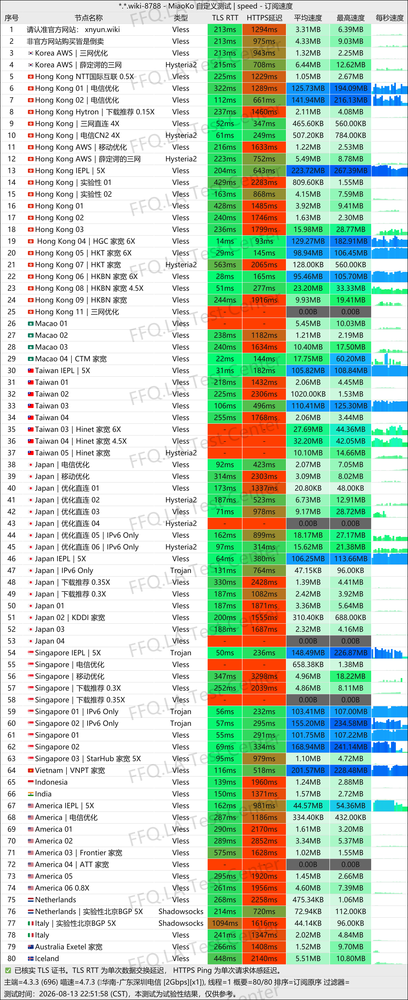
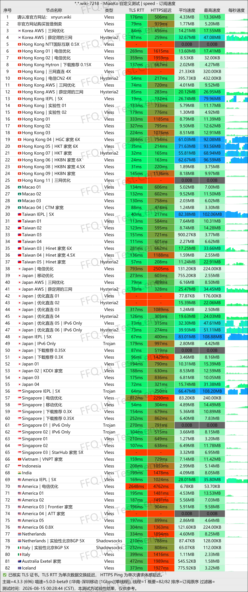
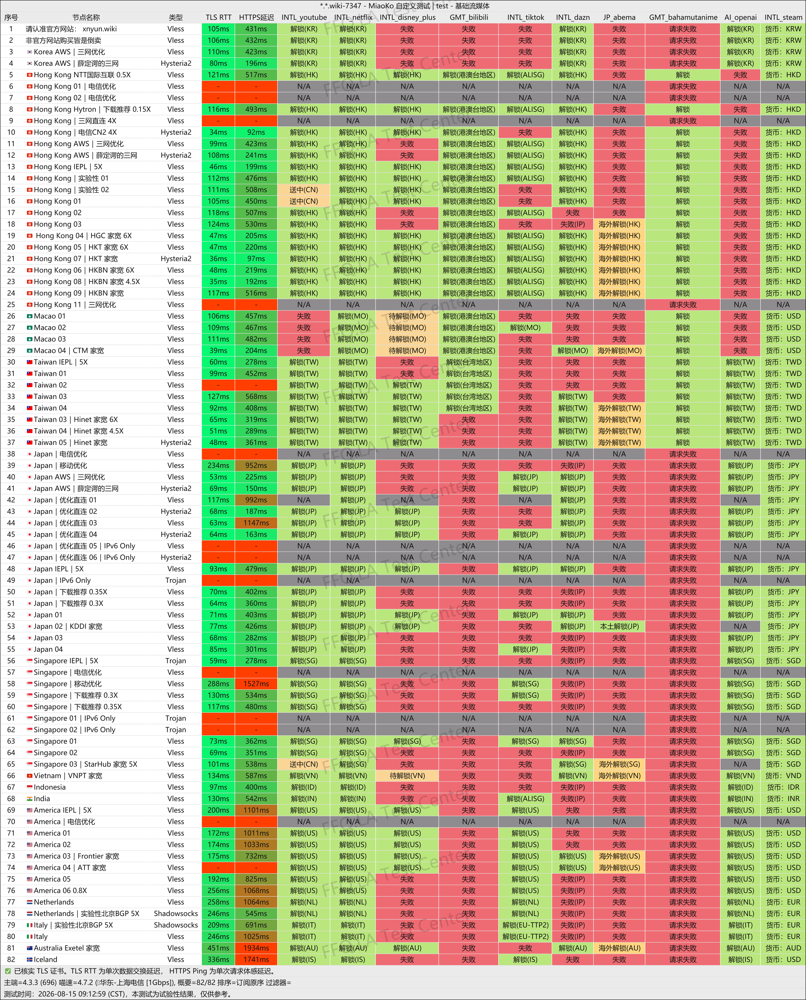
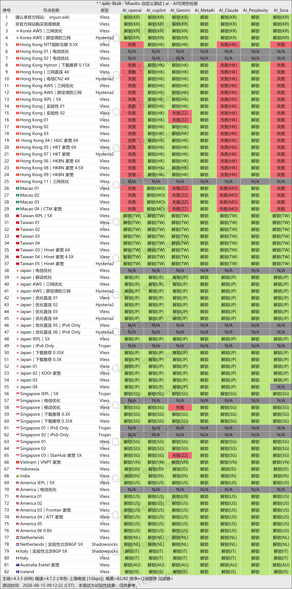
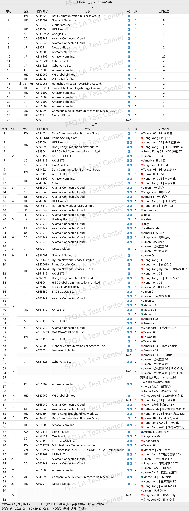

🇨🇳 [中文](README.md) | 🇺🇸 English | 🇷🇺 [Русский](README_RU.md) | 🇮🇷 [فارسی](README_FA.md)

# XnYun NianYun VPN Official Website (Updated November 5, 2026)

XnYun NianYun VPN Official Website<br>
Latest Address 01: [xnncl.com](https://to.iix.im/xny01)<br>
Latest Address 02: [xnyun.wiki](https://to.iix.im/xny01)<br>
Official Website: [nianyun.cloud](https://to.iix.im/xny01)<br>

2026 Best VPN Recommendations and Proxy Node Sharing: [https://github.com/jdnei/JiChangTuiJian](https://github.com/jdnei/JiChangTuiJian)<br>

## Telegram VPN Community #AD

[VPN Giveaway Group](https://331024.de/archives/choujiang) | [VPN Chat Group](https://331024.de/archives/choujiang) | [VPN Trial Group](https://331024.de/archives/choujiang)<br>

[https://331024.de/archives/choujiang](https://331024.de/archives/choujiang)

## Invitation Code

```bash
LPoFUpAL
```

## Coupon Code / Discount Code

`12% OFF. Expires October 10.`

```bash
国庆快乐
```

## Introduction

NianYun VPN is a multi-protocol VPN service provider offering network nodes in multiple regions.

The service supports access to streaming platforms and AI tools, making it suitable for everyday internet browsing, video streaming, and online entertainment.

## Advantages

**Multiple Protocols:** NianYun supports a variety of proxy protocols, including SS, Trojan, Hysteria2, VLESS, and AnyTLS. These protocols allow users to choose compatible clients and configurations for different network environments.

**Optimized Network Routes:** NianYun provides nodes in multiple regions and offers route optimizations for China Telecom, China Unicom, and China Mobile connections.

**Streaming and AI Support:** The service supports access to popular streaming platforms and AI services, with flexible subscription plans suitable for everyday browsing, entertainment, and multi-device usage.<br>

**Residential IP Nodes:** NianYun also provides `home broadband nodes` and `residential proxy nodes` in selected countries.<br>

## Subscription Plans

| Plan | Price | Traffic Allowance | Speed Limit | Devices | Billing Options | Annual Discount | Main Features |
|---|---|---:|---:|---:|---|---|---|
| Small & Simple | ¥12/month | 150 GB/month | 1500 Mbps | 5 | Monthly / Quarterly / Semiannual / Annual / 2 Years / 3 Years / One-time | Approximately 17% OFF annually; save ¥24 | Traffic resets monthly; suitable for personal smartphones and computers, web browsing, social media, and light streaming; transit and dedicated lines across all plans |
| Just Right | ¥18/month | 200 GB/month | 2000 Mbps | 5 | Monthly / Quarterly / Semiannual / Annual / 2 Years / 3 Years / One-time | Approximately 18% OFF annually; save ¥38 | Recommended value plan; monthly traffic reset; suitable for smartphones, computers, and tablets; supports HD YouTube/Netflix streaming and everyday downloads |
| Maximum Satisfaction | ¥26/month | 300 GB/month | 2500 Mbps | 5 | Monthly / Quarterly / Semiannual / Annual / 2 Years / 3 Years / One-time | Approximately 21% OFF annually; save ¥64 | High-traffic flagship plan suitable for 4K/8K streaming, heavy downloading, and sharing across multiple devices |
| Long-Term Companion | ¥89 one-time | 1000 GB (credited immediately as a one-time allocation) | 2500 Mbps | 4 | One-time payment | — | Traffic does not reset monthly; service ends when the traffic is exhausted or the validity period expires; suitable for research, business travel, and backup use; shares transit nodes with standard plans |

## 📊 Performance Tests and Analysis

#### 1.1 China Unicom Evening Peak-Hour Speed Test

<br>

#### 1.2 China Telecom Evening Peak-Hour Speed Test

<br>

#### 1.3 China Mobile Evening Peak-Hour Speed Test

<br>

#### 2. Streaming Platform Unblocking Report

<br>

#### 3. AI Service Unblocking Report

<br>

#### 4. Entry and Exit Node Analysis

<br>
