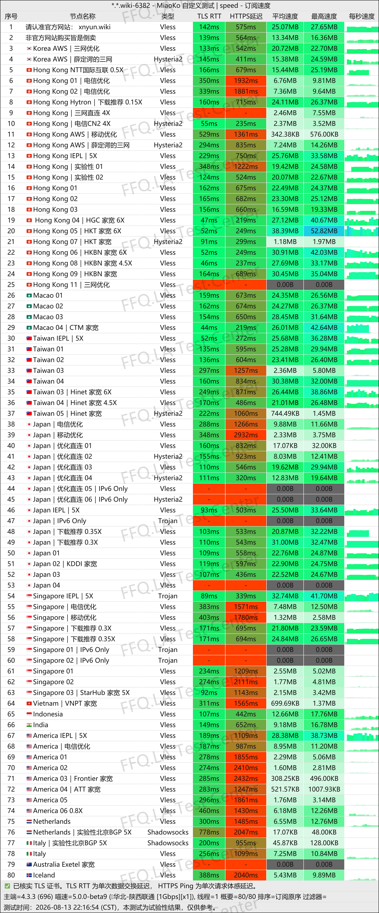
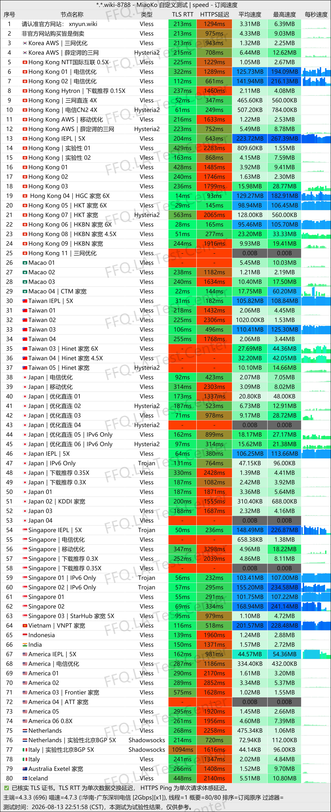
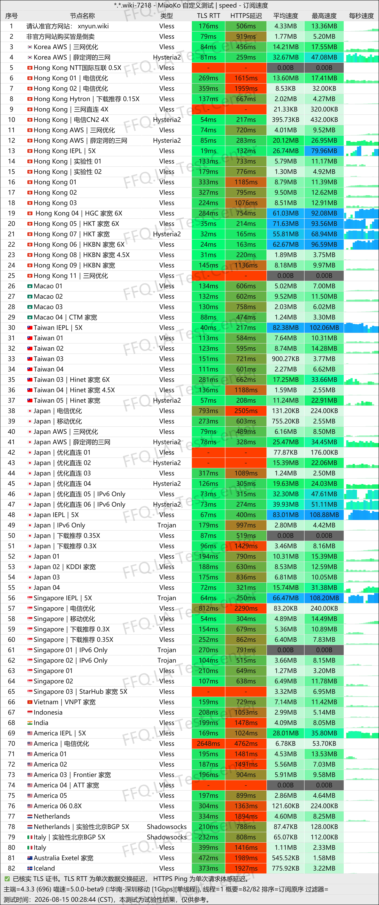
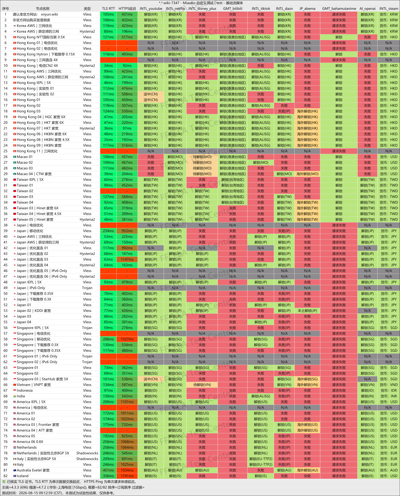
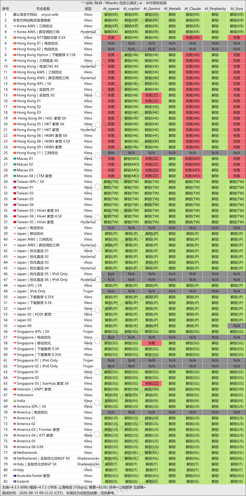
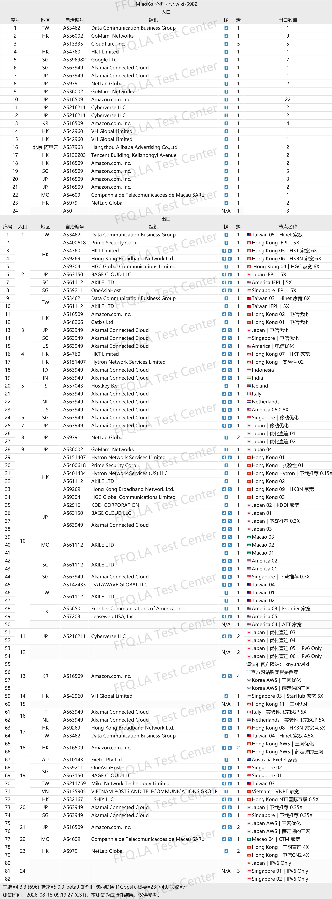

 🇨🇳 [中文](README.md) | 🇺🇸 [English](README_EN.md) | 🇷🇺 [Русский](README_RU.md) | 🇮🇷 فارسی

# وب‌سایت رسمی فیلترشکن XnYun NianYun(به‌روزرسانی 13 نوامبر 2026)
وب‌سایت رسمی فیلترشکن XnYun NianYun<br>
جدیدترین آدرس ۰۱: [xnncl.com](https://to.iix.im/xny01)<br>
جدیدترین آدرس ۰۲: [xnyun.wiki](https://to.iix.im/xny01)<br>
وب‌سایت رسمی: [nianyun.cloud](https://to.iix.im/xny01)<br>

معرفی بهترین سرویس‌های VPN و اشتراک‌گذاری سرورهای پروکسی در سال ۲۰۲۶: [https://github.com/jdnei/JiChangTuiJian](https://github.com/jdnei/JiChangTuiJian)<br>

## انجمن تلگرامی VPN #AD

[گروه قرعه‌کشی VPN](https://331024.de/archives/choujiang) | [گروه گفت‌وگوی VPN](https://331024.de/archives/choujiang) | [گروه تست VPN](https://331024.de/archives/choujiang)<br>

[https://331024.de/archives/choujiang](https://331024.de/archives/choujiang)

## کد دعوت

```bash
LPoFUpAL
```

## کد تخفیف

`۱۲٪ تخفیف؛ پایان اعتبار: ۱۰ اکتبر`

```bash
国庆快乐
```

## معرفی

NianYun یک سرویس VPN با پشتیبانی از پروتکل‌های مختلف است که سرورهایی در مناطق جغرافیایی متعدد ارائه می‌دهد.

این سرویس از دسترسی به پلتفرم‌های پخش آنلاین و ابزارهای هوش مصنوعی پشتیبانی می‌کند و برای وب‌گردی روزمره، تماشای ویدئو و سرگرمی‌های آنلاین مناسب است.

## مزایا

**پشتیبانی از پروتکل‌های مختلف:** NianYun از پروتکل‌های SS، Trojan، Hysteria2، VLESS و AnyTLS پشتیبانی می‌کند. این تنوع به کاربران اجازه می‌دهد کلاینت‌ها و تنظیمات مناسب را بر اساس شرایط شبکه خود انتخاب کنند.

**مسیرهای ارتباطی بهینه‌شده:** این سرویس سرورهایی در مناطق مختلف ارائه می‌دهد و مسیرهای ارتباطی را برای شبکه‌های China Telecom، China Unicom و China Mobile بهینه می‌کند.

**پشتیبانی از سرویس‌های پخش آنلاین و هوش مصنوعی:** NianYun امکان دسترسی به پلتفرم‌های محبوب پخش آنلاین و ابزارهای هوش مصنوعی را فراهم می‌کند. طرح‌های اشتراک متنوع آن برای وب‌گردی روزمره، سرگرمی و استفاده از چندین دستگاه مناسب هستند.<br>

**سرورهای دارای IP خانگی:** این سرویس در برخی کشورها، `سرورهای اینترنت خانگی` و `سرورهای پروکسی مسکونی` نیز ارائه می‌دهد.<br>

## طرح‌های اشتراک

| طرح | قیمت | حجم ترافیک | محدودیت سرعت | تعداد دستگاه | دوره‌های پرداخت | تخفیف سالانه | ویژگی‌های اصلی |
|---|---|---:|---:|---:|---|---|---|
| Small & Simple / کوچک و کاربردی | ¥12 در ماه | 150 گیگابایت در ماه | 1500 مگابیت بر ثانیه | ۵ دستگاه | ماهانه / سه‌ماهه / شش‌ماهه / سالانه / دوساله / سه‌ساله / یک‌بار پرداخت | حدود ۱۷٪ تخفیف سالانه؛ صرفه‌جویی ¥24 | بازنشانی ماهانه ترافیک؛ مناسب استفاده شخصی با تلفن همراه و رایانه، وب‌گردی، شبکه‌های اجتماعی و تماشای سبک محتوای آنلاین؛ استفاده از خطوط انتقال و خطوط اختصاصی در تمام طرح‌ها |
| Just Right / متعادل | ¥18 در ماه | 200 گیگابایت در ماه | 2000 مگابیت بر ثانیه | ۵ دستگاه | ماهانه / سه‌ماهه / شش‌ماهه / سالانه / دوساله / سه‌ساله / یک‌بار پرداخت | حدود ۱۸٪ تخفیف سالانه؛ صرفه‌جویی ¥38 | طرح پیشنهادی با ارزش خرید بالا؛ بازنشانی ماهانه ترافیک؛ مناسب تلفن همراه، رایانه و تبلت؛ پشتیبانی از تماشای YouTube/Netflix با کیفیت بالا و دانلودهای روزمره |
| Maximum Satisfaction / پرحجم | ¥26 در ماه | 300 گیگابایت در ماه | 2500 مگابیت بر ثانیه | ۵ دستگاه | ماهانه / سه‌ماهه / شش‌ماهه / سالانه / دوساله / سه‌ساله / یک‌بار پرداخت | حدود ۲۱٪ تخفیف سالانه؛ صرفه‌جویی ¥64 | طرح پرچم‌دار با ترافیک بالا؛ مناسب تماشای ویدئوهای 4K/8K، دانلودهای سنگین و استفاده مشترک از چندین دستگاه |
| Long-Term Companion / همراه بلندمدت | ¥89 یک‌بار پرداخت | 1000 گیگابایت (تمام حجم به‌صورت یکجا اختصاص داده می‌شود) | 2500 مگابیت بر ثانیه | ۴ دستگاه | یک‌بار پرداخت | — | بدون بازنشانی ماهانه ترافیک؛ سرویس پس از اتمام ترافیک یا پایان اعتبار متوقف می‌شود؛ مناسب تحقیقات، سفرهای کاری و استفاده پشتیبان؛ از سرورهای انتقال مشترک با طرح‌های معمولی استفاده می‌کند |

## 📊 آزمایش عملکرد و تحلیل

#### ۱.۱ آزمایش سرعت China Unicom در ساعات اوج مصرف شبانه

<br>

#### ۱.۲ آزمایش سرعت China Telecom در ساعات اوج مصرف شبانه

<br>

#### ۱.۳ آزمایش سرعت China Mobile در ساعات اوج مصرف شبانه

<br>

#### ۲. گزارش رفع محدودیت سرویس‌های پخش آنلاین

<br>

#### ۳. گزارش دسترسی به سرویس‌های هوش مصنوعی

<br>

#### ۴. تحلیل سرورهای ورودی و خروجی

<br>
