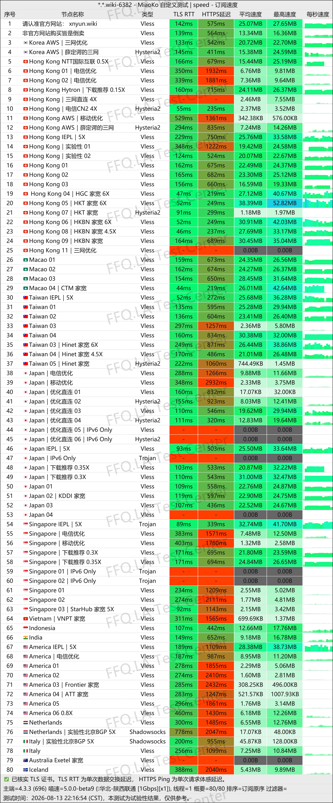
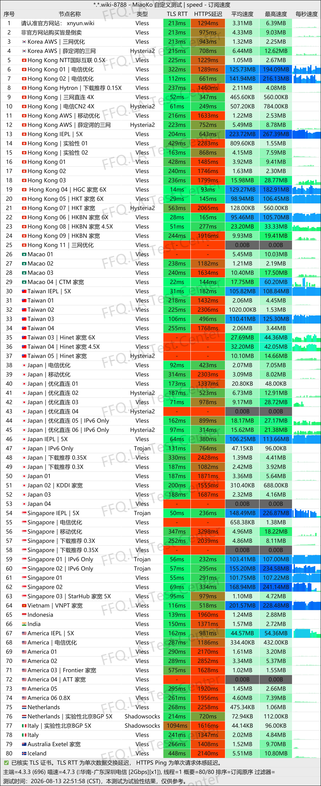
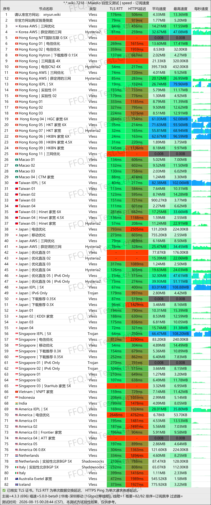
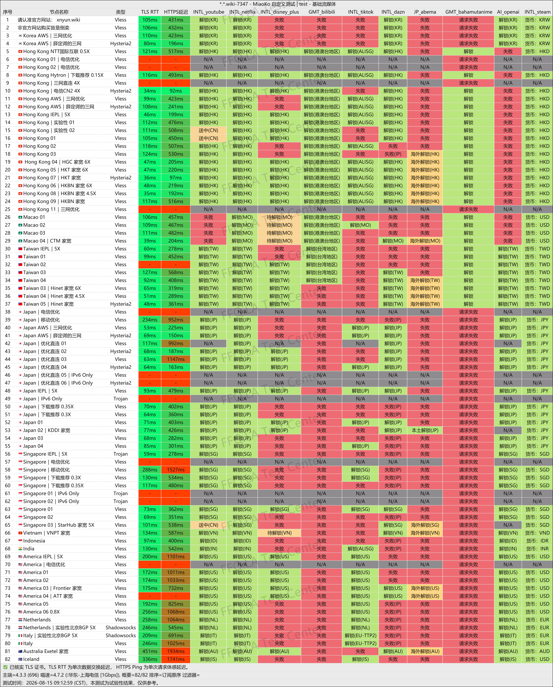
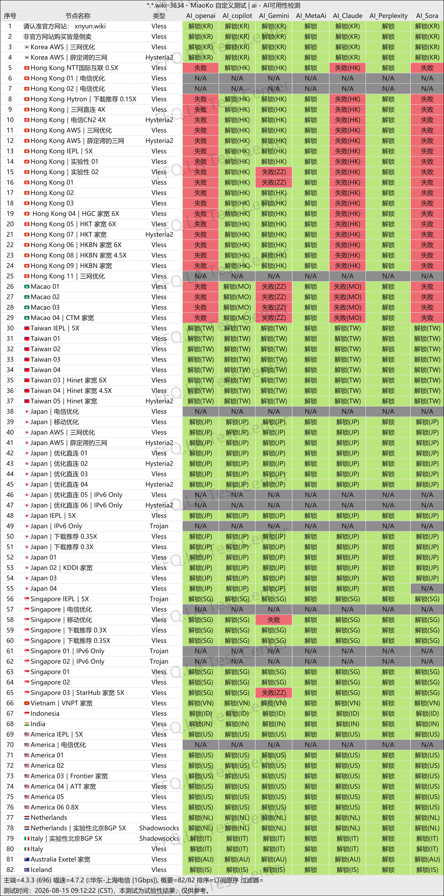
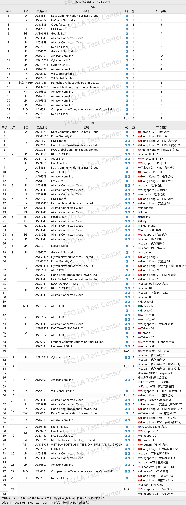

🇨🇳 [中文](README.md) | 🇺🇸 [English](README_EN.md) | 🇷🇺 Русский | 🇮🇷 [فارسی](README_FA.md)

# Официальный сайт XnYun NianYun VPN (обновлено 13 ноября 2026)

Официальный сайт XnYun NianYun VPN<br>
Новый адрес 01: [xnncl.com](https://to.iix.im/xny01)<br>
Новый адрес 02: [xnyun.wiki](https://to.iix.im/xny01)<br>
Официальный сайт: [nianyun.cloud](https://to.iix.im/xny01)<br>

Лучшие VPN-сервисы и прокси-серверы 2026 года: [https://github.com/jdnei/JiChangTuiJian](https://github.com/jdnei/JiChangTuiJian)<br>

## Telegram-сообщество VPN #AD

[Группа розыгрышей VPN](https://331024.de/archives/choujiang) | [Чат VPN](https://331024.de/archives/choujiang) | [Группа тестирования VPN](https://331024.de/archives/choujiang)<br>

[https://331024.de/archives/choujiang](https://331024.de/archives/choujiang)

## Пригласительный код

```bash
LPoFUpAL
```

## Промокод / Код скидки

`Скидка 12%. Срок действия — до 10 октября.`

```bash
国庆快乐
```

## Описание

NianYun — VPN-сервис с поддержкой нескольких протоколов, предоставляющий серверы в различных регионах мира.

Сервис обеспечивает доступ к стриминговым платформам и инструментам искусственного интеллекта. Он подходит для повседневного использования интернета, просмотра видео и онлайн-развлечений.

## Преимущества

**Поддержка различных протоколов:** NianYun работает с SS, Trojan, Hysteria2, VLESS и AnyTLS. Благодаря этому пользователи могут выбирать совместимые приложения и настройки для различных сетевых условий.

**Оптимизированные сетевые маршруты:** Сервис предоставляет серверы в нескольких регионах и оптимизирует соединения для сетей China Telecom, China Unicom и China Mobile.

**Поддержка стриминговых платформ и ИИ:** NianYun обеспечивает доступ к популярным потоковым сервисам и инструментам искусственного интеллекта. Гибкие тарифные планы подходят для обычного просмотра сайтов, онлайн-развлечений и использования нескольких устройств.<br>

**Домашние и резидентские IP-адреса:** В некоторых странах доступны `серверы с домашним интернет-подключением` и `резидентские прокси-серверы`.<br>

## Тарифные планы

| Тариф | Цена | Объём трафика | Ограничение скорости | Устройства | Варианты оплаты | Годовая скидка | Основные особенности |
|---|---|---:|---:|---:|---|---|---|
| Small & Simple / Компактный | ¥12/мес. | 150 ГБ/мес. | 1500 Мбит/с | 5 | Ежемесячно / Ежеквартально / За полгода / Ежегодно / За 2 года / За 3 года / Единовременно | Около 17% скидки при годовой оплате; экономия ¥24 | Ежемесячное обновление трафика; подходит для личного смартфона и компьютера, просмотра сайтов, социальных сетей и умеренного стриминга; транзитные и выделенные линии во всех тарифах |
| Just Right / Оптимальный | ¥18/мес. | 200 ГБ/мес. | 2000 Мбит/с | 5 | Ежемесячно / Ежеквартально / За полгода / Ежегодно / За 2 года / За 3 года / Единовременно | Около 18% скидки при годовой оплате; экономия ¥38 | Рекомендуемый тариф с хорошим соотношением цены и возможностей; ежемесячное обновление трафика; подходит для смартфона, компьютера и планшета; поддерживает просмотр YouTube/Netflix в HD и повседневные загрузки |
| Maximum Satisfaction / Максимальный | ¥26/мес. | 300 ГБ/мес. | 2500 Мбит/с | 5 | Ежемесячно / Ежеквартально / За полгода / Ежегодно / За 2 года / За 3 года / Единовременно | Около 21% скидки при годовой оплате; экономия ¥64 | Флагманский тариф с большим объёмом трафика; подходит для просмотра видео в 4K/8K, интенсивных загрузок и использования нескольких устройств |
| Long-Term Companion / Долгосрочный | ¥89 единовременно | 1000 ГБ (весь объём предоставляется сразу) | 2500 Мбит/с | 4 | Единовременная оплата | — | Трафик не обновляется ежемесячно; обслуживание прекращается после исчерпания трафика или окончания срока действия; подходит для исследований, деловых поездок и резервного использования; использует транзитные узлы совместно с обычными тарифами |

## 📊 Тестирование производительности и анализ

#### 1.1 Тест скорости China Unicom в вечерние часы пик

<br>

#### 1.2 Тест скорости China Telecom в вечерние часы пик

<br>

#### 1.3 Тест скорости China Mobile в вечерние часы пик

<br>

#### 2. Отчёт о разблокировке стриминговых сервисов

<br>

#### 3. Отчёт о доступности сервисов искусственного интеллекта

<br>

#### 4. Анализ входных и выходных узлов

<br>
